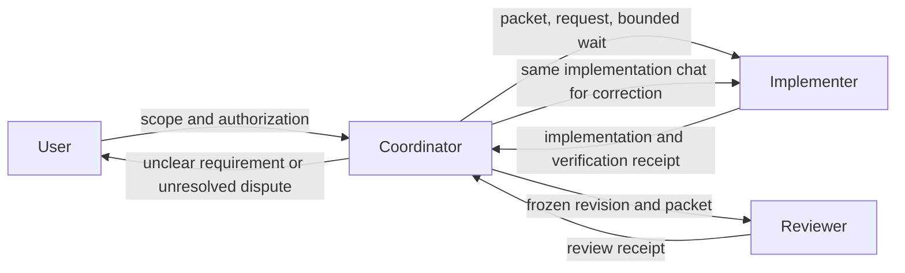

# Coordinator boundaries

The coordinator dispatches work, relays evidence, and handles authorized
workflow actions. It is not an engineering reviewer. Its decisions use the
ticket contract, repository configuration, Git/provider metadata, and worker
receipts; implementation and correctness judgments stay with the workers.

## Coordinator inputs and limits

| Input | Permitted use |
| --- | --- |
| Ticket requirements, relationships, status, and user clarifications | Define the requested scope, dependencies, and acceptance criteria. |
| Repository instructions, configured commands, and integration capabilities | Include required instructions and commands in the worker handoff. Reading a command is not permission to run it. |
| Git identity, checkout/branch identity, clean status, base/head SHAs | Bind actions and receipts to the correct repository and revision. Do not inspect source or interpret a diff. |
| Worker IDs, status, receipts, and evidence references | Wait, detect completion/blockers, validate bindings, and route results. A status or commentary update is not a receipt; a worker-supplied route cannot authorize publication. |
| Deadlines, budgets, and provider metadata | Decide whether a permitted action can proceed and reconcile external state. |

During routine ticket execution, the coordinator does not read production
source, interpret diffs, execute tests or smoke checks, diagnose failures, or
write independent technical findings. It may read repository instructions and
configuration needed to construct a complete assignment. These are prompt and
workflow boundaries, not an operating-system sandbox.

## Routing scenarios

| Scenario | Coordinator action | Engineering owner |
| --- | --- | --- |
| Normal implementation | Dispatch the approved scope, wait for the receipt, and route the frozen revision for review. | Implementer investigates, changes, verifies, documents, and commits; reviewer independently assesses the revision. |
| Unclear product requirement | Ask the user one focused scope question and capture the answer before dispatch or correction. Do not infer a product decision from source code. | User resolves the requirement; implementer investigates technical feasibility after scope is clear. |
| Failed or missing check evidence | Relay the exact failed/missing evidence to the worker responsible for producing it. Keep acceptance blocked until corrected evidence is returned. | Implementer corrects implementation or verification; reviewer re-evaluates the resulting revision. |
| Technical disagreement | Ask the reviewer to assess the disputed evidence independently. If the disagreement remains unresolved, present both positions and ask the user. | Reviewer owns the technical assessment; user resolves any remaining decision. |
| Changed implementation HEAD | Invalidate the prior review binding and route the new committed revision for review. An unexplained or uncommitted change requires reconciliation first. | Implementer explains and records intended changes; reviewer assesses the new SHA. |
| Missing receipt | Request the receipt from its original producing worker using the existing chat and action binding. Do not infer success from a timeout, idle state, or commentary. | The worker that produced the missing evidence returns it. |
| Epic combined acceptance | Require combined integration verification at the actual integrated revision before final acceptance. | Implementer plans/runs the combined verification; reviewer independently assesses its evidence. |

The selected coordinator profile is preserved. Worker profiles remain exactly
`gpt-5.6-luna`/`xhigh` for implementation and `gpt-6.1-sol`/`high` for review;
role boundaries do not authorize changing a model or effort.

## Handoff flow

The coordinator's request, wait, metadata-read, and receipt-read events remain
distinct from the implementer's and reviewer's engineering actions. A changed
user requirement produces a newly captured scope and immutable packet before
work resumes.

Compact result acceptance is one fenced local mutation: the cursor, prepared
action/worker binding, and any phase transition are validated before the
registry is written. A failed transition therefore remains retryable without
redispatching. New external dispatch also validates the immutable packet's
session/ticket/worktree, authority, and deadline; after expiry, observation and
reconciliation remain possible but new work does not.
