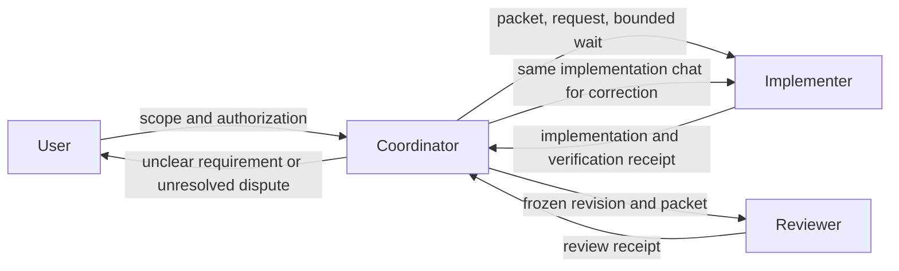

# Taiga ticket-loop automation

The [ticket-loop improvement plan](../goals/ticket-loop-improvements/README.md)
records the 2026-09-30 trial findings and the six delivered offline improvement
goals. Offline helper acceptance is separate from actual-host and publication
verification, which remain pending without a separately authorized trial.
The trial exercised ordinary worker chats and review but stopped at the user's
request before push/PR delivery; it is not full publication acceptance evidence.

This repository contains an explicitly invoked repo-local skill at
`.agents/skills/taiga-ticket-loop/`. It coordinates ordinary Codex chats
outside the .NET MCP server. It is not installed globally and it does not
start a chat, schedule a heartbeat, write Taiga, push a branch, create a PR,
merge, or deploy merely because the files exist.

The offline core is PowerShell 7:

```powershell
pwsh -NoProfile -File tests/automation/Test-Automation.ps1
```

The harness uses synthetic state and Taiga/provider observations plus a local
bare Git remote. It does not contact live Taiga or GitHub. Actual host and
provider smoke evidence remains separate from fixture success.

Story child-task status handling is defined in
`.agents/skills/taiga-ticket-loop/references/child-task-status-contract.md`.
`workflow-taiga.ps1 -Operation capture-context` captures complete task pages,
including closed tasks, and emits immutable task bindings. The binding includes
the selected task set, source aliases, baseline status/version, exact criteria,
project/story identity, and a recomputed digest. The
`resolve-status-mapping` operation validates project/resource-specific status
metadata and uses `in_progress` as the review fallback only when no review
status is configured; the mapping retains the captured metadata and recomputed
metadata/mapping digests. Workers emit append-only progress through
`workflow-progress.ps1`; the checkpoint records the immutable packet binding,
task IDs, run/action identity, sequences, revisions, criterion evidence, and
idempotent event IDs. Existing event identities remain stable across checkpoint
upgrades, and retrying a captured event remains idempotent. A packet may carry
`trustedRevisions`; when present, progress outside
that assignment is rejected. The first event uses the packet action and
corrections form a non-reusable continuation chain; later milestones may remain
within the active correction action. Progress is
evidence of a milestone, not reviewer acceptance or a Done transition.
The coordinator consumes that stream with
`workflow-coordinate.ps1 -Operation relay-task-progress` on a bounded
observation. It advances a persisted per-consumer cursor only into durable
pending work, requires explicit outcome acknowledgement after reconciliation,
and leaves `ready_for_review` in the mapped review state (or the documented
in-progress fallback) until an independent reviewer accepts it. Pending work
is retained across restart and failed writes.
`workflow-taiga.ps1` provides `prepare-task-write`,
`apply-reviewed-task-transition`, `reconcile-task-write`, and
`reconcile-task-scope` for coordinator-owned, version-bound journals. Review
receipts can include one `taskAcceptances` entry per claimed completed task;
every write must carry the exact packet selected-task set, required criteria,
and revision-bound progress receipt. Accepted/Done is rejected without a
matching reviewer identity, packet/action binding, accepted task ID, criterion
evidence, and reviewed SHA. Status writes reject fabricated mappings by
recomputing provenance from the captured status metadata.
`finalize` does not accept those labels as evidence. For a nonempty story scope,
it requires `stateRoot`, `progressRoot`, `reviewActionId`, `expectedCriteria`,
the validated task `statusMapping`, and one `{ taskId, eventId,
taskWriteActionId }` reference per selected task. It resolves the reviewer
action and its hash-checked receipt from the registry, validates the receipt's
per-task acceptances at the final SHA, resolves each persisted coordinator task
write, and derives the returned final evidence from the records. Unknown action
or event IDs, tampered receipts, pending/uncertain writes, and stale or
cross-task references fail closed.

## Story operator guidance

Configure mappings per project and resource from discovered Taiga status
metadata, for example `not_started`, `in_progress`, `awaiting_review`,
`accepted`, and optional `blocked` task status IDs. If a task resource has no
review status, `awaiting_review` deliberately falls back to `in_progress` and
the task remains not-Done until reviewer acceptance. Workers report
`started`, `blocked`, and `ready_for_review`; the coordinator is the only
writer of task status.

Operators should read child tasks for milestone and review detail while the
parent story remains the single branch/chat/PR and keeps its existing merge
completion policy. A blocked or rejected child reopens only that child after
new revision-bound evidence; unrelated tasks and human edits are preserved.
New, removed, or reparented children require scope reconciliation before any
status write. Parent completion requires revision-bound accepted evidence for
every selected child; a started or ready-for-review milestone is insufficient.
The lifecycle verifier covers restart midway through synchronization and refuses
parent completion when selected-task acceptance evidence is missing. No real-host
trial is implied by offline fixture success.

The story-loop review handoff is event-driven within the confirmed scope. A
`ready_for_review` event dispatches one request to the persistent reviewer;
routine findings go directly to the implementer and correction-ready revisions
go directly back to the same reviewer, without coordinator action. Exact task
acceptance also goes directly to the implementer, who owns current-version
Taiga reconciliation and next-task advancement in `per_task` mode. Initial
readiness, routine corrections, and task acceptance do not wake the coordinator
or require a coordinator reminder. The reviewer sends only final story approval
and exceptional escalation to the coordinator.
`story_end_only` records implementation-ready milestones and defers task
acceptance and review to the final story review. Duplicate or stale events,
idle status, changed scope, unknown delivery, and revision conflicts stop for
coordinator reconciliation. The contracts and offline behavior fixtures are
`.agents/skills/taiga-story-loop/references/automatic-review-flow.md`,
`.agents/skills/taiga-story-loop/references/routing-and-escalation.md`,
`.agents/skills/taiga-story-loop/scripts/validate-automatic-review-flow.ps1`,
and `.agents/skills/taiga-story-loop/scripts/validate-routing.ps1`.
The milestone-routing change and its exact offline commands are recorded in
[issue #89 validation](issue-89-validation.md).

The end-of-turn handoff contract and no-polling recovery fixture are recorded
in [issue #90 validation](issue-90-validation.md). Confirmed initial and
correction-ready deliveries now stop the implementer turn; only a current
reviewer message or evidenced recovery resumes the same chat.

The delivered local helpers include compact coordination, worker-owned
verification, timing/usage/cost measurement, and sanitized acceptance replay.
See [measurement reporting](measurement-reporting.md), the
[comparison template](comparison-template.md), and the
[deliberate trial guide](installation-and-trial.md).

## Explicit operational start

Invoke the skill after selecting the exact issue, task, story, or epic and
authorizing the required actions. The coordinator discovers the current
workspace repository, Git common directory, repository instructions, Taiga
context, status mappings, and validation commands when they are available. For
TaigaMCP it verifies and uses freshly fetched `origin/master` automatically;
you do not need to repeat the repository path, remote, or base branch.

The shortest useful invocation is:

```text
Use $taiga-ticket-loop with the standard authorized-run profile for ticket/epic
42 in the GroceryRecipeWizard project.
```

The reusable profile authorizes the selected worker chats, worktree/branch,
Taiga progress updates, reviewed push/PR delivery, Codex PR attachment, and one
coordinator heartbeat for continuation/merge observation. It excludes automatic
merge, force-push, deployment, branch deletion, credentials, unrelated scope,
and writes outside the selected ticket/epic. Add dependencies, validation
commands, status choices, or a different repository mapping only when they are
not discoverable or differ from the defaults. Automatic merge and force-push
remain off. The full copyable template is in
`.agents/skills/taiga-ticket-loop/assets/operational-invocation-template.md`.

The implementer is exactly `gpt-5.6-luna` with `xhigh`. The reviewer is exactly
`gpt-6.1-sol` with `high`. Historical records differ by host: the planning host
did not advertise the reviewer on 2026-09-29, while the 2026-09-30 trial record
reports it on another host. Check exact model/effort availability on the
current host for each run and stop if a requested profile is unavailable. Do
not silently fall back. The coordinator preserves the user's selected profile.

## State and recovery

The heartbeat path has no dependency on the local workflow-state registry or a
custom recovery application. Persist only the continuation returned by the
native heartbeat plan, together with the run identity (`runId`, coordinator
thread, and scope hash). The continuation records the existing automation ID,
its reservation state, and the last confirmed schedule state; it is the source
of truth for the next plan.

Heartbeat setup is a two-phase native protocol. First persist the
`create_reserved` continuation. Reconcile the provider by reservation or
scope before creating anything. A fresh `creationReconciliation` with
`outcome=not_found` permits one provider create request; persist the returned
`create_pending` continuation before sending it. If the call is interrupted,
the next plan performs reconciliation again and never retries creation from an
old observation. If reconciliation finds an existing automation, adopt its ID
instead of creating another one.

Schedule changes use the same confirmation rule. A pause or reactivation plan
returns a pending target while retaining the last confirmed `scheduleState`.
Persist that continuation, reconcile the provider result, and pass an explicit
confirmation before planning the next lifecycle step. Use an `applied`
confirmation when the requested target is observed; use `unchanged` or
`failed` with the last confirmed provider state when the update did not apply.
The latter clears the stale pending target so the next plan can retry. Failed
or interrupted updates therefore remain retryable and cannot make a paused or
active result look confirmed.

For a manual recovery check, read the recent coordinator/worker chat, inspect
the actual checkout and branch, provider/PR state, and current Taiga state,
then call the native `heartbeat-plan` operation with the same run identity and
saved continuation. A `reconcile_heartbeat_creation` or
`reconcile_heartbeat_schedule` result is a read/reconcile step, not permission
to replay an ambiguous write. Normal worker messages and user approvals remain
the workflow triggers; the heartbeat stays quiet when nothing meaningful has
changed.

## Branch, review, and PR evidence

Each executable ticket fetches its configured remote and records a fresh base
SHA before creating a unique `codex/<kind>-<ref>-<slug>-<run-suffix>` branch and
managed worktree. The reviewed `base..HEAD` revision must equal the pushed PR
head. A review receipt is accepted only when it is bound to the expected
run/action/ticket, exact `gpt-6.1-sol`/`high` settings, structurally complete
criteria/check evidence, and (for publication) passing criteria with zero-exit
checks. A `changes_requested` or `blocked` receipt may retain failed checks as
evidence for correction. Target movement is compared with
the recorded target/base SHA rather than feature HEAD; movement, source edits,
changed requirements, or new material PR feedback invalidate approval and
return through the same implementation/review chats. Review corrections are
driven by current reviewer evidence and user decisions; the recovery protocol
imposes no fixed correction count or elapsed deadline.

Both review helpers use the shared versioned contract in
`.agents/skills/taiga-ticket-loop/references/review-receipt-v1.schema.json`.
Expected criteria are compared by packet order, ID, and exact text. Legacy
`resolved` is normalized to `fixed` only when no unresolved evidence
contradicts it; the original receipt is preserved and every normalization is
reported. See the [receipt compatibility reference](../../.agents/skills/taiga-ticket-loop/references/review-receipts.md).

Malformed receipts use `workflow-review.ps1 -Operation route`: lossless legacy
normalization stays local, while other repair requests return to the original
reviewer. Evidence repairs and production corrections are reconciled from
their current evidence rather than a fixed round or elapsed-time budget.
Evidence amendments require a fresh reviewer decision. Re-reviews bind a
`reviewDelta` from the previous SHA; documentation amendments require a new
commit and an explicit assessment. Reused checks need evidence IDs and a
justification.

Verification logs and evidence records live outside the mutable registry.
`workflow-evidence.ps1` binds them to a validated packet, prepared action, exact
profile, and committed revision. It keeps expected-red fixtures, passing
assertions, ordinary check failures, and intentional host shutdowns separate
while retaining raw exit codes. Counts come from validated structured records;
reported-only counts retain their source and timestamp. The
[evidence contract](../../.agents/skills/taiga-ticket-loop/references/evidence-contract.md)
documents storage, validation, and retention.

One PR is created or reused per executable leaf/story ticket. PR delivery,
checks, merge provenance, and Taiga Done are separate facts. Default leaf Done
requires an observed merge; an epic additionally requires every required story
merged and combined acceptance at the integrated revision. Closed-unmerged PRs,
missing checks, response-lost writes, and ambiguous observations require
reconciliation or user input, never blind replay.

## Coordinator and worker roles

The coordinator reads ticket requirements and relationships, repository
instructions/configuration, Git identity/status/SHAs, worker statuses and
receipts, deadlines, and provider metadata. It dispatches work, relays results,
and handles authorized external actions. In routine operation it does not read
production source, interpret diffs, run tests or smoke checks, diagnose
failures, or create independent technical findings. The implementer owns source
investigation, implementation, verification, documentation, and commits. The
reviewer owns independent correctness assessment and technical acceptance.

Missing implementation evidence goes to its producing worker; changed HEAD
invalidates review and requires assessment of the new revision; unclear product
requirements go to the user; and unresolved technical disagreements go from
the reviewer to the user. Epic combined verification belongs to the
implementer, with the reviewer assessing evidence at the integrated revision.
These prompt and routing rules guide behavior but are not an operating-system
sandbox. See the skill's [coordinator boundary matrix](../../.agents/skills/taiga-ticket-loop/references/coordinator-boundaries.md)
for scenario details.



Each worker handoff references an immutable, versioned assignment packet by
absolute path and hash. It holds stable criterion IDs/text, ticket identity,
complete-context file reference/hash, repository/worktree/base, required
commands, explicit authority, deadlines, and exact profiles. The packet and
copied full-context artifact live under the persistent local state root, outside
the registry and source worktree. A scope change gets a new packet ID and scope
hash; unresolved product requirements block dispatch until the user clarifies
them. The prompt stays short because the worker reads the complete packet and
its repository instructions directly. See the skill's
[assignment packet contract](../../.agents/skills/taiga-ticket-loop/references/assignment-packets.md).

Preflight checks only current host capability metadata, configured repository
requirements, and explicit authority. It accepts any supported visible-browser
provider when a repository requires browser work; the implementer runs the
required interaction. See the skill's
[preflight troubleshooting](../../.agents/skills/taiga-ticket-loop/references/preflight-troubleshooting.md).

## Recovery commands

The coordinator uses native heartbeat and thread controls directly. Supply the
saved run identity and continuation to the heartbeat planner, then persist its
returned continuation before making any provider change:

```text
heartbeat-plan {
  runId,
  coordinatorThreadId,
  continuation,
  lifecycle: "active"
}
```

Use the returned native automation request only after its reconciliation or
confirmation precondition is satisfied. The planner does not infer failure
from elapsed time and does not require a local registry, a fixed deadline, or
a manual restart command.

The host coordinator must reconcile unresolved desktop, Taiga, Git, GitHub, and
heartbeat actions using their receipts. A pending `clientThreadId` is not a
usable worker ID. A timeout or commentary is not a completed result. A failed
final Taiga update preserves verified PR/merge evidence and remains in
`finalizing` or `needs_input` rather than restarting implementation.

## Scope and limitations

The helper is local and one-host: human interference and cross-host claims are
outside its locking guarantee. GitHub CLI/connector authentication, actual
chat/schedule availability, check providers, squash/rebase provenance, and
live Taiga permissions require a separately authorized smoke exercise. The
skill does not implement automatic board-priority discovery, automatic model
selection, automatic merging, stacked PRs, deployment, plugin distribution, or
an SDK runner.
