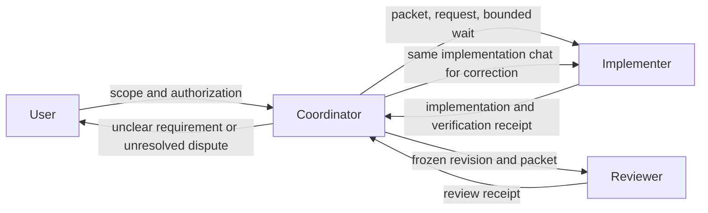

# Taiga ticket-loop automation

The [ticket-loop improvement plan](../goals/ticket-loop-improvements/README.md)
records the 2026-09-30 trial findings and the six delivered offline improvement
goals. Offline helper acceptance is separate from actual-host and publication
verification, which remain pending without a separately authorized trial.
The trial exercised ordinary worker chats and review but stopped at the user's
request before push/PR delivery; it is not full publication acceptance evidence.

This repository contains an explicitly invoked repo-local skill at
`.agents/skills/taiga-ticket-loop/`. It coordinates ordinary Codex chats
outside the .NET MCP server. It is not installed globally and it does not
start a chat, schedule a heartbeat, write Taiga, push a branch, create a PR,
merge, or deploy merely because the files exist.

The offline core is PowerShell 7:

```powershell
pwsh -NoProfile -File tests/automation/Test-Automation.ps1
```

The harness uses synthetic state and Taiga/provider observations plus a local
bare Git remote. It does not contact live Taiga or GitHub. Actual host and
provider smoke evidence remains separate from fixture success.

Story child-task status handling is defined in
`.agents/skills/taiga-ticket-loop/references/child-task-status-contract.md`.
`workflow-taiga.ps1 -Operation capture-context` captures complete task pages,
including closed tasks, and emits immutable task bindings. The
`resolve-status-mapping` operation validates project/resource-specific status
metadata and uses `in_progress` as the review fallback only when no review
status is configured. Workers emit append-only progress through
`workflow-progress.ps1`; the checkpoint records task IDs, run/action identity,
sequences, revisions, criterion evidence, and idempotent event IDs. Progress
is evidence of a milestone, not reviewer acceptance or a Done transition.
The coordinator consumes that stream with
`workflow-coordinate.ps1 -Operation relay-task-progress` on a bounded
observation. It advances a per-consumer cursor, proposes only changed task
states, and leaves `ready_for_review` in the mapped review state (or the
documented in-progress fallback) until an independent reviewer accepts it.

The delivered local helpers include compact coordination, worker-owned
verification, timing/usage/cost measurement, and sanitized acceptance replay.
See [measurement reporting](measurement-reporting.md), the
[comparison template](comparison-template.md), and the
[deliberate trial guide](installation-and-trial.md).

## Explicit operational start

Invoke the skill after selecting the exact issue, task, story, or epic and
authorizing the required actions. The coordinator discovers the current
workspace repository, Git common directory, repository instructions, Taiga
context, status mappings, and validation commands when they are available. For
TaigaMCP it verifies and uses freshly fetched `origin/master` automatically;
you do not need to repeat the repository path, remote, or base branch.

The shortest useful invocation is:

```text
Use $taiga-ticket-loop with the standard authorized-run profile for ticket/epic
42 in the GroceryRecipeWizard project.
```

The reusable profile authorizes the selected worker chats, worktree/branch,
Taiga progress updates, reviewed push/PR delivery, Codex PR attachment, and one
coordinator heartbeat for continuation/merge observation. It excludes automatic
merge, force-push, deployment, branch deletion, credentials, unrelated scope,
and writes outside the selected ticket/epic. Add dependencies, validation
commands, status choices, or a different repository mapping only when they are
not discoverable or differ from the defaults. Automatic merge and force-push
remain off. The full copyable template is in
`.agents/skills/taiga-ticket-loop/assets/operational-invocation-template.md`.

The implementer is exactly `gpt-5.6-luna` with `xhigh`. The reviewer is exactly
`gpt-6.1-sol` with `high`. Historical records differ by host: the planning host
did not advertise the reviewer on 2026-09-29, while the 2026-09-30 trial record
reports it on another host. Check exact model/effort availability on the
current host for each run and stop if a requested profile is unavailable. Do
not silently fall back. The coordinator preserves the user's selected profile.

## State and recovery

State is outside all worktrees at
`%LOCALAPPDATA%/TaigaMCP/agent-review-automation` by default. Use
`-StateRoot` for a disposable fixture. The registry contains a schema version,
CAS revision, sessions, ticket claims, repository/host reservations, actions,
worker cursors, evidence, and bounded events. Writes use an exclusive short
lock, a flushed same-directory temporary file, atomic replacement, and a valid
`.bak` snapshot. Version-1 registries are migrated to the current
canonical-ticket schema on read; divergent legacy duplicates stop for manual
recovery without falling back to an older snapshot. Only malformed JSON may
recover from `.bak`. Inspect first after a crash; a pending or uncertain action is
reconciled against its target before another call. Do not free an uncertain
slot merely because its lease expired.

Ticket controls are scoped. Pause/cancel first record a `pausing` or
`cancelling` intent and block new dispatch, actions, slots, and transitions.
After workers are observed idle, `reconcile-intent` requires `quiescent=true`
and no pending/uncertain actions before changing the phase and releasing a
slot; unresolved actions retain their reservations. Parent tickets are stored
once, with child/story aliases resolving through the canonical ticket record.
Every mutation requires the current registry revision and owner generation.
Resume revalidates chat, checkout, source, scope, and pending actions. Waiting
for a dependency or merge releases execution capacity but retains ownership.
Duplicate ticks and stale revisions are rejected.

## Branch, review, and PR evidence

Each executable ticket fetches its configured remote and records a fresh base
SHA before creating a unique `codex/<kind>-<ref>-<slug>-<run-suffix>` branch and
managed worktree. The reviewed `base..HEAD` revision must equal the pushed PR
head. A review receipt is accepted only when it is bound to the expected
run/action/ticket, exact `gpt-6.1-sol`/`high` settings, structurally complete
criteria/check evidence, and (for publication) passing criteria with zero-exit
checks. A `changes_requested` or `blocked` receipt may retain failed checks as
evidence for correction. Target movement is compared with
the recorded target/base SHA rather than feature HEAD; movement, source edits,
changed requirements, or new material PR feedback invalidate approval and
return through the same implementation/review chats. The default review budget
is initial round 0 plus three corrections.

Both review helpers use the shared versioned contract in
`.agents/skills/taiga-ticket-loop/references/review-receipt-v1.schema.json`.
Expected criteria are compared by packet order, ID, and exact text. Legacy
`resolved` is normalized to `fixed` only when no unresolved evidence
contradicts it; the original receipt is preserved and every normalization is
reported. See the [receipt compatibility reference](../../.agents/skills/taiga-ticket-loop/references/review-receipts.md).

Malformed receipts use `workflow-review.ps1 -Operation route`: lossless legacy
normalization stays local, while other repair requests return to the original
reviewer. `workflow-state.ps1 -Operation record-receipt-repair` stores up to two
format/evidence repairs per result separately from the three production
correction rounds. Exhaustion or an expired run budget returns `needs_input`.
Evidence amendments require a fresh reviewer decision. Re-reviews bind a
`reviewDelta` from the previous SHA; documentation amendments require a new
commit and an explicit assessment. Reused checks need evidence IDs and a
justification.

Verification logs and evidence records live outside the mutable registry.
`workflow-evidence.ps1` binds them to a validated packet, prepared action, exact
profile, and committed revision. It keeps expected-red fixtures, passing
assertions, ordinary check failures, and intentional host shutdowns separate
while retaining raw exit codes. Counts come from validated structured records;
reported-only counts retain their source and timestamp. The
[evidence contract](../../.agents/skills/taiga-ticket-loop/references/evidence-contract.md)
documents storage, validation, and retention.

One PR is created or reused per executable leaf/story ticket. PR delivery,
checks, merge provenance, and Taiga Done are separate facts. Default leaf Done
requires an observed merge; an epic additionally requires every required story
merged and combined acceptance at the integrated revision. Closed-unmerged PRs,
missing checks, response-lost writes, and ambiguous observations require
reconciliation or user input, never blind replay.

## Coordinator and worker roles

The coordinator reads ticket requirements and relationships, repository
instructions/configuration, Git identity/status/SHAs, worker statuses and
receipts, deadlines, and provider metadata. It dispatches work, relays results,
and handles authorized external actions. In routine operation it does not read
production source, interpret diffs, run tests or smoke checks, diagnose
failures, or create independent technical findings. The implementer owns source
investigation, implementation, verification, documentation, and commits. The
reviewer owns independent correctness assessment and technical acceptance.

Missing implementation evidence goes to its producing worker; changed HEAD
invalidates review and requires assessment of the new revision; unclear product
requirements go to the user; and unresolved technical disagreements go from
the reviewer to the user. Epic combined verification belongs to the
implementer, with the reviewer assessing evidence at the integrated revision.
These prompt and routing rules guide behavior but are not an operating-system
sandbox. See the skill's [coordinator boundary matrix](../../.agents/skills/taiga-ticket-loop/references/coordinator-boundaries.md)
for scenario details.



Each worker handoff references an immutable, versioned assignment packet by
absolute path and hash. It holds stable criterion IDs/text, ticket identity,
complete-context file reference/hash, repository/worktree/base, required
commands, explicit authority, deadlines, and exact profiles. The packet and
copied full-context artifact live under the persistent local state root, outside
the registry and source worktree. A scope change gets a new packet ID and scope
hash; unresolved product requirements block dispatch until the user clarifies
them. The prompt stays short because the worker reads the complete packet and
its repository instructions directly. See the skill's
[assignment packet contract](../../.agents/skills/taiga-ticket-loop/references/assignment-packets.md).

Preflight checks only current host capability metadata, configured repository
requirements, and explicit authority. It accepts any supported visible-browser
provider when a repository requires browser work; the implementer runs the
required interaction. See the skill's
[preflight troubleshooting](../../.agents/skills/taiga-ticket-loop/references/preflight-troubleshooting.md).

## Recovery commands

Inspect a run:

```powershell
pwsh -NoProfile -File .agents/skills/taiga-ticket-loop/scripts/workflow-state.ps1 `
  -Operation inspect
```

Use the exact configured root with `-StateRoot` when inspecting a non-default
run. The helper emits structured JSON and a nonzero exit code for malformed
input, stale revisions, invalid transitions, terminal dispatch, conflicts, or
missing recovery evidence. It never executes model output or ticket text.

The host coordinator must reconcile unresolved desktop, Taiga, Git, GitHub, and
heartbeat actions using their receipts. A pending `clientThreadId` is not a
usable worker ID. A timeout or commentary is not a completed result. A failed
final Taiga update preserves verified PR/merge evidence and remains in
`finalizing` or `needs_input` rather than restarting implementation.

## Scope and limitations

The helper is local and one-host: human interference and cross-host claims are
outside its locking guarantee. GitHub CLI/connector authentication, actual
chat/schedule availability, check providers, squash/rebase provenance, and
live Taiga permissions require a separately authorized smoke exercise. The
skill does not implement automatic board-priority discovery, automatic model
selection, automatic merging, stacked PRs, deployment, plugin distribution, or
an SDK runner.
