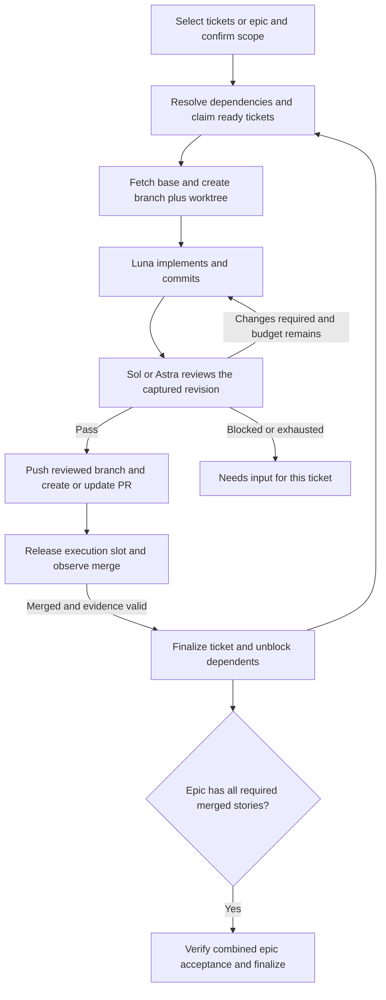

# Agent implementation and review automation

Status: planned; no automation, skill, helper, worker chats, schedules, pushes, or PRs have been created by these plans.
Prepared 2026-09-29 against TaigaMCP commit `3f047a5` and its 35 implemented MCP tools. Scope revised to include concurrent tickets, fresh-base feature branches, PR delivery, and epic coordination.

## Goal and location

Let Blake select tickets or an epic, choose their priority and reviewer, and have a coordinator manage implementation, review corrections, PR delivery, and completion evidence. Preserve the same ordinary Codex conversations across correction rounds.

The skill/helper source will initially live in this repository under `.agents/skills/taiga-ticket-loop/`; it runs separately from the .NET Taiga MCP server. No new repository or application project is required. The skill can later be installed personally for use across code repositories. Workers operate in the repository mapped to their ticket, not necessarily TaigaMCP. Actual run records remain outside Git and all worktrees.

## Agreed design

| Component | Responsibility |
| --- | --- |
| Explicitly invoked Codex skill | Procedure, role prompts, configuration, and host contracts. |
| Ordinary coordinator chat | Own a selected work session, dispatch ready tickets, relay findings, track PRs and epic completion. |
| Ordinary implementation chat per executable ticket | GPT-5.6 Luna with `xhigh`; implement, test, document, commit, and correct findings. |
| Ordinary reviewer chat per executable ticket | GPT-6 Sol with `high`, or GPT-6 Astra with `medium`, selected per ticket/session. |
| PowerShell 7 state helper | Persist sessions, ticket claims, repository slots, action journal, dependency graph, and evidence. No desktop-tool calls. |
| Optional heartbeat per coordinator session | Continue all its active tickets and merge observations; reuse one schedule. |
| Existing Taiga MCP connection | Read requirements/relationships and update discussion/status. |
| Git and authenticated GitHub CLI or connector | Fetch, push reviewed branches, create/update PRs, observe checks and merges. |

**No subagents.** Apply this to the coordinator, worker templates, and scheduled prompt. Preserve exact requested models/efforts; report unavailable combinations instead of falling back. Each ticket uses one writer; its review is sequential with its implementation. Independent tickets can proceed concurrently.

## Release scope and defaults

- Explicitly selected tickets or an epic's agreed story set; automatic discovery of the next board priority remains deferred.
- Configurable repository concurrency, initially two active ticket pipelines. Each pipeline has its own implementation/reviewer chats, branch, and managed worktree.
- Per-ticket ownership plus repository capacity; no repository-wide lock held throughout implementation.
- Fetch the configured remote before each new ticket and create its feature branch from the captured current base SHA. TaigaMCP currently uses `origin/master`; other repositories supply their own remote/base.
- Branch naming: `codex/<kind>-<ref>-<slug>-<run-suffix>`. Never reset/reuse an unrelated branch.
- Initial review plus at most three correction rounds per ticket by default.
- After verified review, push the branch, create or update one PR, link it in Taiga, and attach it to the relevant Codex chat.
- Automatic push/PR creation is enabled for authorized operational runs. Automatic merge, force-push, deployment, and branch deletion are disabled.
- Default ticket Done requires observed merge and acceptance evidence; PR opening records delivery and the mapped awaiting-merge state. A separately configured leaf policy may finish at PR delivery, but an epic still requires merged story evidence.
- Dependencies normally wait for prerequisite PRs to merge into the configured base. Independent stories can run in parallel. Stacked PRs and shared epic branches are deferred.
- Manual start/status/pause/resume/cancel, optional scheduled continuation, and durable recovery.

“Ready to Merge,” “In Progress,” and “Done” are logical roles mapped to actual project/resource status IDs. Never assume Taiga contains those English names.

## Work-type behavior

| Type | Execution and PR unit | Completion gate |
| --- | --- | --- |
| Issue | Its own worker pair, feature branch, and PR. | Review/checks plus configured delivery/merge policy. |
| Story, standalone or in an epic | One worker pair, branch, and PR covering its selected tasks. | All task evidence and story acceptance; then delivery/merge policy. |
| Task belonging to a story | Work within the owning story run and PR. | Task evidence; parent story acceptance remains independent. |
| Standalone task | Its own worker pair, branch, and PR. | Review/checks plus configured delivery/merge policy. |
| Epic | Coordinate linked story runs; no giant shared implementation branch by default. | All required stories reviewed and merged, then combined epic acceptance verified. |

Epic links can reference other projects. Resolve every story's repository/configuration or report a blocker; never silently omit unmapped work. Required stories already completed need verified historical/integration evidence, not unnecessary new PRs.

## Runtime flow

A blocked ticket does not stop unrelated eligible tickets. Waiting for merge retains ticket ownership but releases execution capacity. The coordinator stays quiet when observations are unchanged.

## Ordered implementation goals

All goals are unimplemented. Keep existing 01–06 filenames stable; those goals build the core, and 07–09 complete the expanded release.

| Goal | Deliverable | Depends on |
| --- | --- | --- |
| [01: Host contract and configuration](01-host-contract.md) | Desktop/GitHub capabilities, model profiles, workflow types, configuration and fixtures. | None |
| [02: Durable run state](02-durable-state.md) | Session/ticket records, ownership, slots, journal, recovery validation. | 01 |
| [03: Skill and chat handoffs](03-skill-and-handoffs.md) | Skill, ordinary worker chats, explicit model settings and checkout receipts. | 01–02 |
| [04: Review and correction loop](04-review-loop.md) | Revision-bound reviews, findings, bounded corrections, acceptance gates. | 03 |
| [05: Taiga workflow integration](05-taiga-integration.md) | Scope snapshots, resource-specific status mapping, reporting and conflict handling. | 04 |
| [06: Scheduled recovery and core validation](06-scheduling-and-validation.md) | Session heartbeat, pause/resume/recovery, core local-chat smoke gate. | 05 |
| [07: Fresh branches and PR delivery](07-branches-and-prs.md) | Fetch/base verification, feature branches, push/PR lifecycle, merge observation. | 06 |
| [08: Concurrent ticket scheduling](08-concurrent-tickets.md) | Per-ticket dispatch, repository limits, dependency scheduling, conflict recovery. | 07 |
| [09: Epic coordination and release acceptance](09-epic-coordination.md) | Story graph, epic aggregation, integrated acceptance and full-release validation. | 08 |

Read [execution instructions](execution-instructions.md), [contracts](contracts.md), and [sources](sources.md). Every goal has four ordered steps, documentation/commit checkpoints, validation, and a definition of done: nine goals and 36 steps total.

Suggested future assignment:

> Implement goal NN in docs/goals/agent-review-automation. Follow the shared contracts and repository instructions. Work in this chat without subagents. Validate and document each step, then commit before proceeding. Use fixtures for external effects. This assignment does not start operational chats/schedules or authorize production pushes, PRs, merges, or Taiga writes unless explicitly stated.

The smoke instructions in goals 06 and 09 are future invocations, not authorization to run them during planning.

## Proposed implementation layout

- `.agents/skills/taiga-ticket-loop/SKILL.md`: explicit workflow entry point.
- `.agents/skills/taiga-ticket-loop/agents/openai.yaml`: disable implicit invocation.
- `.agents/skills/taiga-ticket-loop/references/`: host, GitHub, state, type, and operating contracts.
- `.agents/skills/taiga-ticket-loop/assets/`: role templates and synthetic examples.
- `.agents/skills/taiga-ticket-loop/scripts/workflow-state.ps1`: local JSON bookkeeping.
- `tests/automation/`: offline helper, Git, host, GitHub, Taiga, and recovery fixtures.
- `docs/automation/`: implemented operator/configuration guide and validation evidence.

Keep existing .NET projects intact. PowerShell 7 is the helper runtime.
Use a canonical per-user external state root, initially
`%LOCALAPPDATA%/TaigaMCP/agent-review-automation/`, shared by worktrees.
A personal skill installation is a deployment option, not performed by this plan.

## Release definition of done

- [ ] All nine goals and 36 step checkpoints have completion evidence and commits.
- [ ] Worker chats use the exact models/efforts with no subagents.
- [ ] Two independent ticket pipelines can proceed without sharing source directories or exceeding capacity.
- [ ] Each new ticket starts from a verified freshly fetched base SHA on its own feature branch.
- [ ] Review corrections reuse the same chats; changed source/base/scope invalidates stale approval.
- [ ] Reviewed changes produce one reconciled PR per executable ticket and Taiga/Codex links.
- [ ] Open/closed/merged PRs and missing checks are distinguished; default Done requires merged evidence.
- [ ] Story tasks share the story branch/PR; dependencies wait for verified prerequisite integration.
- [ ] Epic closure requires every required story's reviewed/merged evidence and combined acceptance.
- [ ] Duplicate ticks, crashes and uncertain sends/writes/pushes/PR creation cause reconciliation, not blind retries.
- [ ] Repository checks and offline acceptance pass; actual-host operation is either verified in an authorized smoke exercise or explicitly unverified.
- [ ] No live Taiga data or production GitHub repository is modified by tests.
- [ ] Documentation matches delivered behavior and preserves the unchanged 35-tool MCP baseline.

Deferred after this release: pointing, automatic board-priority intake, reviewer auto-selection, automatic merging, stacked PRs, deployment, multi-host ownership, plugin distribution, and a standalone SDK runner.
